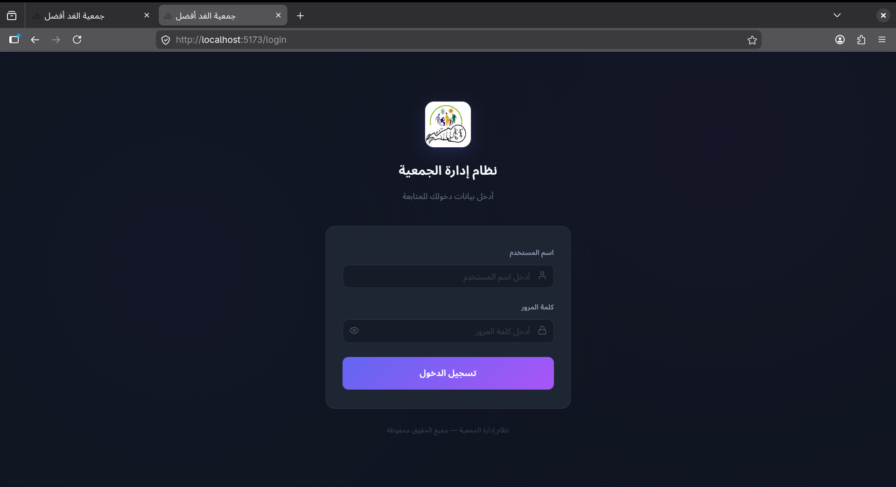
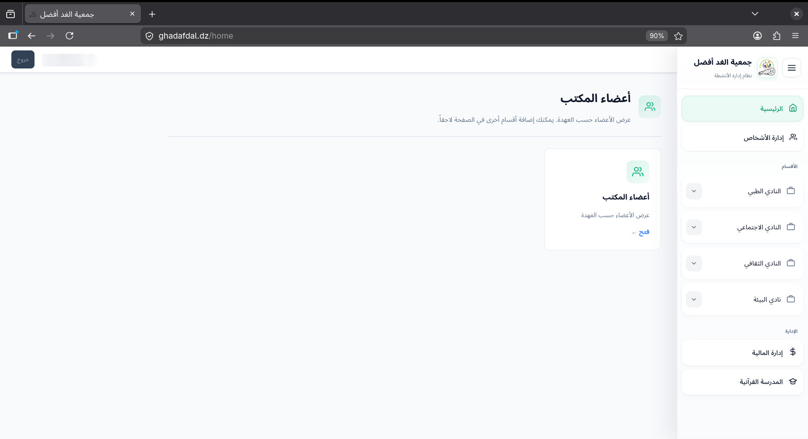
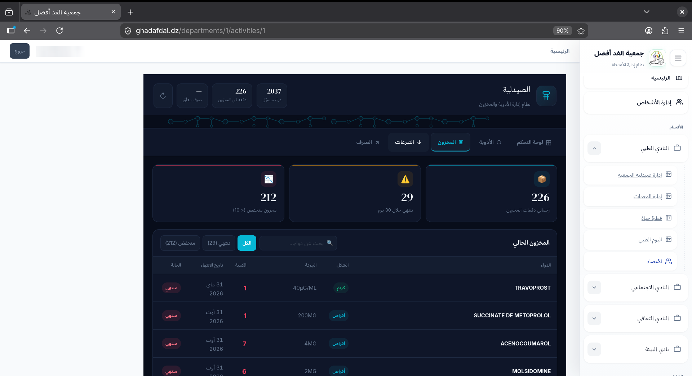
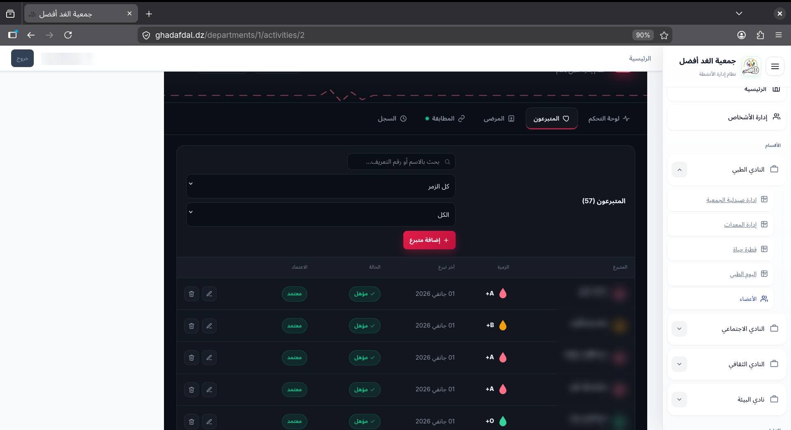
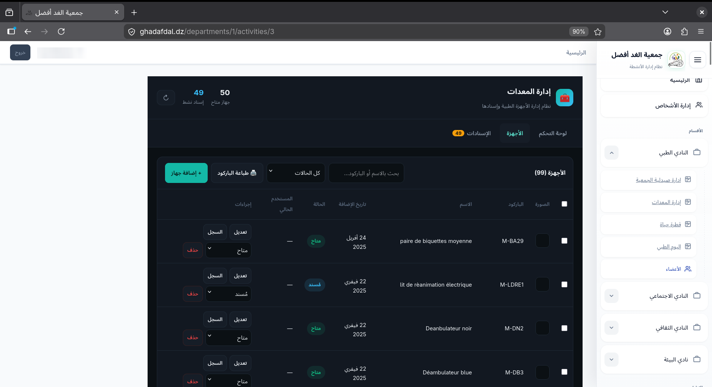
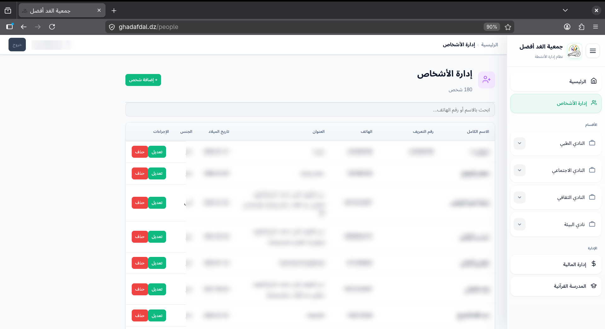
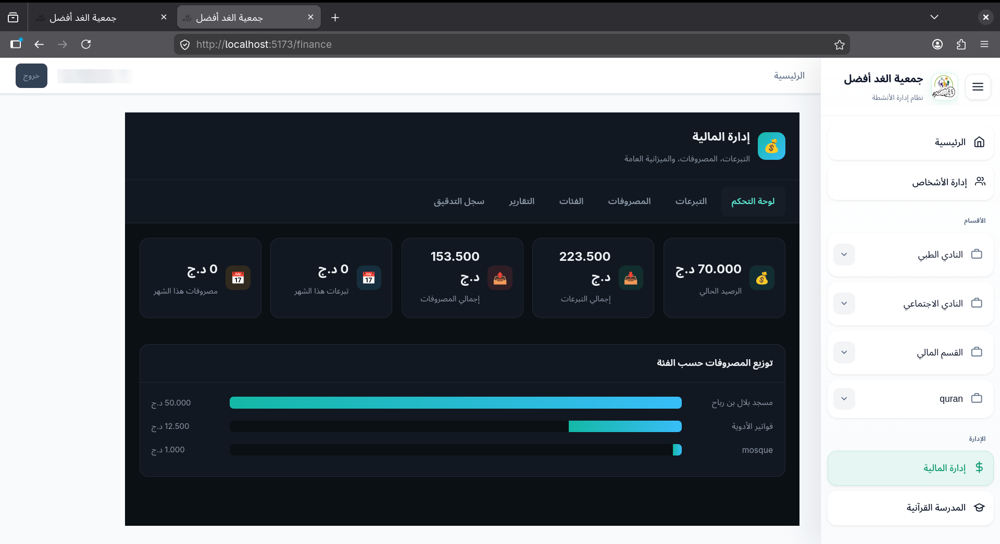
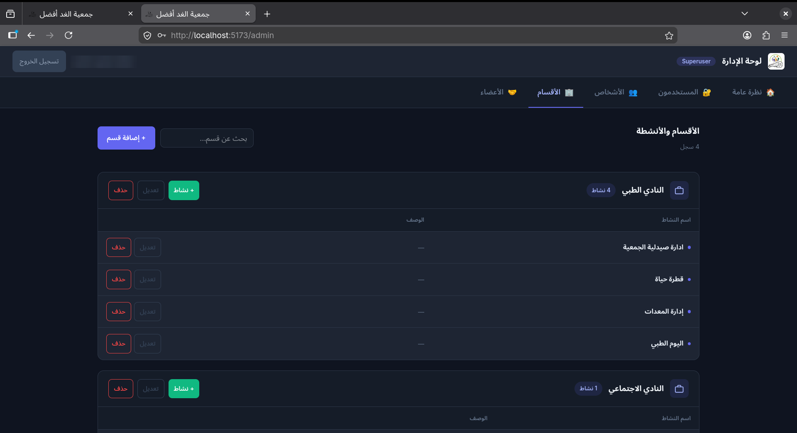
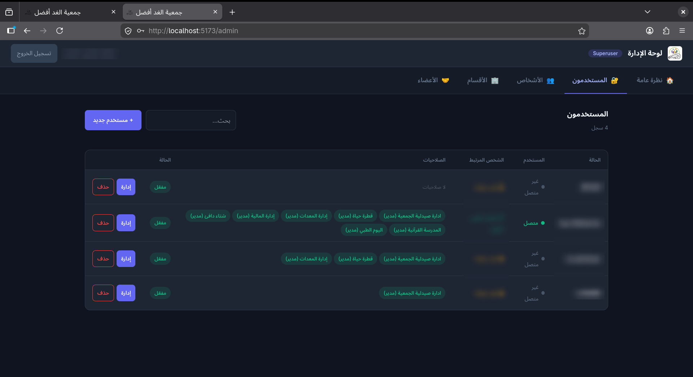

# Ghad Afdal Association Management System
### نظام إدارة جمعية الغد الأفضل

A full-stack web platform I built for a charity association in Algeria to manage its day-to-day activities in one place: pharmacy stock, blood donations, medical equipment, finances, people records, and a Quran school.

**Live deployment:** https://ghadafdal.dz
**Language of the interface:** Arabic (RTL)

> Screenshots below come from the running system. Personal data has been blurred/anonymized.

---

## Screenshots

| Login | Home |
|---|---|
|  |  |

| Pharmacy (stock) | Blood donation (donors) |
|---|---|
|  |  |

| Equipment management | People management |
|---|---|
|  |  |

| Finance dashboard | Admin: departments & activities |
|---|---|
|  |  |

| Admin: users & permissions |
|---|
|  |

---

## Features

### Access control
- JWT authentication (login, token refresh, "me" endpoint)
- Permissions **per activity** with three levels: `viewer` (read), `editor` (add/edit), `manager` (delete/validate)
- Superuser admin panel: manage departments, activities, users, link users to real persons, assign activity access
- Users only see the activities they are assigned to

### Pharmacy
- Drug catalogue (2,000+ entries) with fast search
- Stock tracked **by batch and expiry date**
- Donations / supplies / invoices create stock automatically
- Donation cancellation (within a 5-day window) with atomic stock rollback
- Distributions to beneficiaries with prescription info, validated in a transaction that deducts stock
- Alerts for expiring and low-stock batches

### Blood donation ("قطرة حياة")
- Donors and patients with blood types
- Eligibility rule: 90 days between donations
- Matching of patients with compatible, approved, eligible donors
- Donation history and dashboard statistics
- Arabic PDF donation form generation (ReportLab + Arabic reshaping)

### Medical equipment
- Auto-generated barcodes per machine
- Assign and return equipment by barcode or by record
- Assignment history per machine, status tracking (available, assigned, maintenance, destroyed)
- Printable barcode label sheets (PDF)

### Other modules
- **People management:** central register of persons shared by all activities (180+ records)
- **Finance:** donations, expenses, categories, balance, reports and audit log
- **Quran school:** student records and gender-based filtering
- **Members:** office members by department

---

## Tech stack

| Layer | Technology |
|---|---|
| Backend | Python, Django, Django REST Framework |
| Auth | JWT (djangorestframework-simplejwt) |
| Frontend | React, Vite |
| Database | SQL (Django ORM) |
| PDF / barcodes | ReportLab, python-barcode, arabic-reshaper, python-bidi |
| UI | Custom dark/light design, fully RTL Arabic |

---

## Architecture highlights

- **Custom User model** + `UserProfile` linking a login account to a real `Person`
- **`UserActivityAccess`** is the permission table (user + activity + level), enforced by a reusable DRF permission class that maps HTTP methods to levels (GET → viewer, POST/PUT/PATCH → editor, DELETE → manager)
- **Immutable audit trail:** donation items are never edited; stock is derived through signals
- **Data integrity:** `transaction.atomic()` for stock deduction, validation and cancellation
- **Business rules in models** (cancellation window, 90-day donor eligibility, barcode generation) instead of the UI

---

## Project structure

```
backend/
  models.py          # data model + signals
  serializers.py     # DRF serializers
  permissions.py     # activity-based permission classes
  views.py           # API viewsets and PDF endpoints
  urls.py            # router + custom endpoints
frontend/
  src/pages/         # PharmacyDashboard, QuranSchoolDashboard, ...
  src/api/client.js  # axios client with JWT
```

---

## Getting started

### Backend
```bash
git clone github.com/yassine-space/Association-Management-System
cd backend
python -m venv venv
source venv/bin/activate        # Windows: venv\Scripts\activate
pip install -r requirements.txt
python manage.py migrate
python manage.py createsuperuser
python manage.py runserver
```

### Frontend
```bash
cd frontend
npm install
npm run dev
```
Open http://localhost:5173

### Optional (PDF certificates)
```bash
pip install reportlab arabic-reshaper python-bidi python-barcode pillow
```
Place an Arabic font (e.g. Amiri) in `static/fonts/` and the logo in `static/images/`.

---

## API overview

| Endpoint | Purpose |
|---|---|
| `POST /api/auth/login/` | Get access + refresh tokens and user info |
| `GET /api/auth/me/` | Current user and permissions |
| `/api/drugs/`, `/api/stocks/` | Drug catalogue and stock |
| `/api/donations/{id}/cancel/` | Cancel a donation and roll back stock |
| `/api/distributions/{id}/validate/` | Validate a distribution and deduct stock |
| `/api/patients/with-compatible-donors/` | Blood compatibility matching |
| `/api/certificate/{patient}/{donor}/` | Generate Arabic PDF form |
| `/api/machines/print-barcodes/` | Printable barcode labels |
| `/api/machine-assignments/assign-by-barcode/` | Assign equipment by barcode |

---

## What I learned

- Designing a permission model that fits a real organization
- Keeping stock consistent with transactions and signals
- Building right-to-left Arabic interfaces and Arabic PDF output
- Deploying and maintaining a system used by real users

---

## Author

**chebourou mohammed yassine**
Computer Science student, Algeria
Email: chebourouyassine05@gmail.com
GitHub: https://github.com/yassine-space
LinkedIn: [text](https://www.linkedin.com/in/yassine-chebourou-086b28337?utm_source=share_via&utm_content=profile&utm_medium=member_android)

---

## License
 the code is shared for portfolio purposes only.
